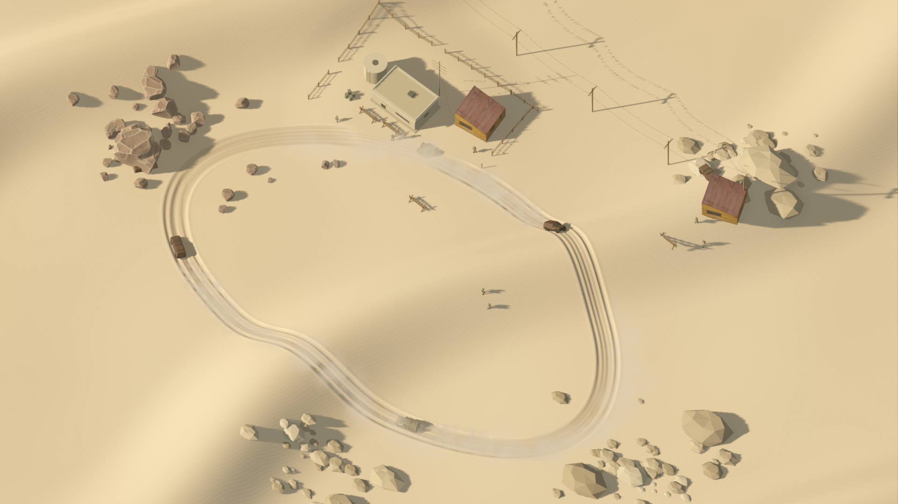
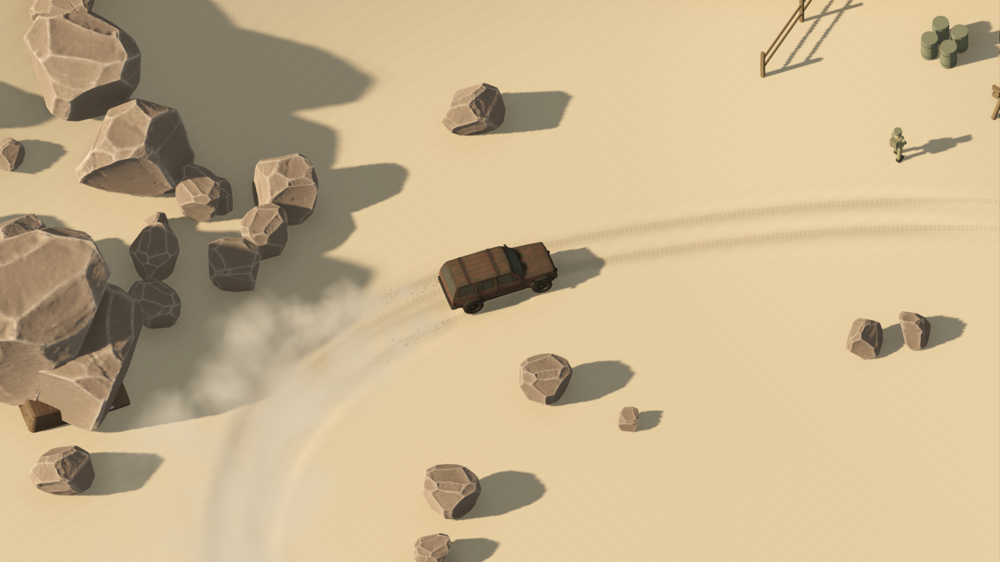

# Endless Drive (formerly Sirocco)

A playable source demo for **Godot 4.7.2 / Forward+**, composed for 1920×1080.
Three vehicles patrol a desert outpost, throwing layered dust and excavating
smooth, persistent tyre ruts. Take over the lead Jeep to drift and deepen the tracks.



## Run

The repository root is the Godot project. The vehicle, barrack and rock assets
originally come from Endless Drive and are bundled under `assets/`.
This is a Godot source demo, not a packaged executable.

On Windows, from the repository root:

```powershell
.\sirocco.ps1 Play -GodotPath 'C:\path\to\Godot_console.exe'
```

The launcher also accepts `GODOT_BIN`, Godot on PATH, or a `Godot_v4*.exe` in your
Downloads or on the Desktop (the console or the windowed build). It imports assets
on the first run and selects Forward+ (also the project default).

The demo now automatically selects **Notebook** on an integrated GPU, including
the Intel Graphics in the Core Ultra 5 135U. Restart the demo to apply it; no scene
rebuild is needed. It retains the vehicles, particles, contact shadows, volumetric
haze and persistent tyre deformation. It culls distant terrain in small chunks,
uses 25 cm fine geometry and 2× MSAA, and omits the faint screen-space indirect-light
bounce. Rendering stays at native 1080p to preserve fine detail. Optional 85% FSR
upscaling provides a little more performance at the cost of fine-edge clarity.

```powershell
# Automatic selection (recommended on this notebook):
.\sirocco.ps1 Play
# Additional performance with slightly reduced internal resolution:
.\sirocco.ps1 Play -Quality Notebook -RenderScale 0.85
# Original full-quality rendering for comparison:
.\sirocco.ps1 Play -Quality Reference
# Weak GPUs: no SSAO/volumetric fog, 2 shadow cascades, 80% FSR:
.\sirocco.ps1 Play -Quality Low
# Real GPU benchmark; frame timing is uncapped and printed after warmup:
.\sirocco.ps1 Benchmark -Quality Auto -Duration 60
```

The scene root also exposes **Quality** in the editor. `Auto` uses the active GPU
type; explicit Notebook/Reference choices override it. For direct Godot launches,
append `-- --quality=notebook` or `-- --quality=reference`; `--render-scale=1` keeps
native resolution. Notebook reduces visible mesh density, not the physical sand
field or compaction rules. Very close views can show a slightly coarser rut edge.

Before the handling update, on this Core Ultra 5 135U / Intel Graphics notebook, matched 60-second tests at
1080p measured **17.7 → 32.5 FPS** (median-equivalent) at native resolution, or
**38.0 FPS** with the optional 85% FSR setting. Frame-time p95 improved from
67.98 to 37.99 ms at native resolution. See the scene documentation for logs and
test conditions; this is a local measurement, not a locked-60-FPS claim.

On other platforms, with `godot` on PATH:

```sh
godot --headless --editor --import --path . --rendering-method forward_plus
godot --path . --rendering-method forward_plus --resolution 1920x1080 res://desert_battlefield/desert_battlefield.tscn
```

For editing, import `project.godot`, open
`res://desert_battlefield/desert_battlefield.tscn` and run that scene with **F6**.
Use Forward+ for the full lighting, fog and dust presentation.

## Controls

- **Tab:** take control of the lead Jeep / return to cinematic mode.
- **W / up:** accelerate. **S / down:** brake; hold after stopping to reverse.
- **A/D or left/right:** steer, with a smaller steering angle at high speed.
- **Shift or Space:** handbrake: locks the rear wheels (they slide and lose side
  grip, the front keeps steering and, in 4×4 or on the van, driving).
- **G / L:** 4×4 or 4×2 (Jeep) / lock the differentials: more traction, but the
  car is held to 30 km/h and the tyres scrub in bends. With open differentials a
  stuck car spins only the tyre with less grip on each axle; locked, all driven
  tyres turn together.
- **F:** headlights on/off (tail lights brighten when braking, a white light
  shows in reverse).
- **Escape:** return to autonomous patrol.
- **R:** reset the car — to the start of the current test, otherwise to its route.
- **P:** pause vehicles and particles (the orbit camera still moves).
- **C / Shift+C:** camera — Overview, Close top-down, Chase, Low chase, Orbit
  (drag with the mouse), Roof view.
- **+ / − / mouse wheel:** zoom or follow distance of the current camera
  (top-down down to an 8 m wide view).
- **1–9, 0 / T:** jump straight to a test (T = next, Shift+T = previous): circuit
  start, asphalt slalom, gravel, clay, mud, water ford, moguls + jump, snow, ice,
  grass, then (T) wet asphalt, skid pad, dune jump, rocky trail and two mid-lap
  circuit entries (mud and grass; snow, ice and the hill).
- **V:** switch car: the Chevrolet M1009 (lead) and the Jeep Cherokee (plus the
  IZH van with `-- --patrol`).
- **Q:** switch graphics quality while playing (Notebook / Reference / Low).
- **F11 / Alt+Enter:** fullscreen.
- **K:** next weather (forest highlands): clear, cloudy, rain, downpour, frost,
  snowfall.
- **H / F1:** controls overlay.

## Lesná vrchovina (forest highlands)

A second world in `offroad/`, driven with the same cars, handling, ruts, dust,
lights, cameras and phone controls. Start it directly:

```powershell
.\sirocco.ps1 Play -Scene Highlands
```

A 720 m world: a forested river valley in the middle, a snowy mountain to the
north-west, and a range of mountains closing it off.

- **Camp (start)** with the Endless Drive repair barrack.
- **River:** 9 m wide and 1.2 m deep. It changes along its course: a milky
  turquoise glacial stream in the north (fast, 1.7 m/s), a clear green forest
  river in the valley, a muddy brown river in the south. The roads ford it in
  shallow water (0.3–0.75 m). The current pushes a wading car downstream.
- **Forest pond** at the end of a dirt road: still, dark water.
- **Mud bog** across a wet meadow.
- **Hill climb** on rock slabs, up to 33 % grade.
- **Forest road** on packed dirt with puddles.
- **Quarry pit** with a steep gravel ramp, rock walls and boulders.
- **Field road:** a 700 m dirt loop around the valley; gravel shows only in its
  two worn wheel tracks.
- **Long road:** a 1.6 km dirt loop (gravel wheel tracks) around the whole world,
  joined to the valley by two dirt roads.
- **Serpentines:** a 510 m dirt road with three hairpins up the mountain,
  climbing 52 m at about 10 % (up to about 20 % in the hairpins). Above about
  34 m it is packed snow, and the top legs have patches of glazed ice.

**Ruts:** soft ground deforms: grass, forest floor, dirt, gravel, clay, snow and
mud. In Highlands, grass, dirt, gravel and other surfaces dig less deeply;
mud and snow retain their deeper deformation. A rut in turf or soil shows
the churned mud underneath. The rut field (256 m) moves with the car, so ruts
form anywhere in the world; ruts left more than about 80 m behind fade out.

**Weather** (offroad/weather.gd) changes on its own every two to three minutes:
clear, cloudy, rain, downpour, frost and snowfall. **K** (or the POČASIE button
on phones) jumps to the next one. The ground reacts more slowly than the sky:

- **Rain** soaks the ground in about half a minute. Dirt roads turn to mud. Wet soil and turf lose up to
  a third of their grip, rut nearly twice as deep and roll heavier, and stop
  raising dust. Asphalt and rock get slippery. The ground darkens and shines,
  and puddles collect in hollows and ruts. It dries over a few minutes in the
  sun. The river rises by up to 45 cm (the pond by half) a minute or two
  after the rain and spreads over the low banks; it falls back slowly.
- **Snowfall** below freezing: flakes drift down around the camera and the snow
  settles patch by patch, first on turf and forest floor, later on roads and
  rock. Tyres press grey-blue tracks into it. Snow which takes the grip,
  ruts and particles of snow, even on roads and rock. It melts above freezing
  and soaks the ground.
- **Frost** hardens soil (shallower ruts), puts hoar frost on the grass, and
  glazes wet roads and rock into black ice.

The sky, sun, fog, river surface and falling rain or snow follow the weather.
The HUD shows the weather and the state of the ground under the car, for
example "Tráva · mokrá".

Vegetation and rocks come from four Sketchfab packs (CC BY 4.0, credited in
`assets/ASSET_LICENSES.md`):

- **Forest:** about 6,600 low-poly kit trees (10–16 m).
- **Feature trees:** 110 realistic trees (including Tree Animate) beside the
  trails and camp, with automatic levels of detail.
- **Undergrowth:** 3,000 bushes and hedges along forest edges.
- **Ground cover:** about 15,000 tufts of grass, clover and flowers, drawn within
  55 m.
- **Rocks:** 700 granite and mossy boulders.

Tree trunks and larger boulders are solid. Invisible walls at the foot of the
boundary mountains keep the cars in the world.

**Ground textures:** ten tileable textures (colour with roughness, plus normal
maps), sampled at two scales to hide the repeat:

- grass, forest floor, dirt, gravel and rock (rock goes triplanar on steep slopes);
- mud on the river bed, under the water;
- river banks, damp at the waterline and drying into cracked clay about a metre
  higher (matte, so they cannot be mistaken for water);
- churned trail mud with pools on the tracks and in the bog;
- wind-packed snow and glazed ice.

**Performance:** the ground is built at load from a baked 0.75 m height grid, in
144 chunks of 60 m: full detail within 150 m of the camera (110 m on phones),
a 3 m version beyond, with skirts hiding the seams. Each tree's leaf textures
are packed into one atlas, so a kit tree draws in 2 calls instead of 6 (bushes,
grass and flowers in 1 instead of up to 6). Vegetation is batched per 90 m. The
terrain, bushes and ground cover cast no shadows.

| RTX 3070, 1080p, Reference | first version | 360 m world | 720 m world |
|---|---|---|---|
| Draw calls | ~3,700 | ~600 | ~600–700 |
| Frame rate | 87–113 FPS | 139–178 FPS | 132–160 FPS |

`offroad/bench_highlands.gd` measures it. **1–9, 0 / T** jump to the twelve test
spots. Two new grounds join the shared surface table: forest road (`DIRT`) and
forest floor (`FOREST`). Both worlds start with the Chevrolet M1009 and the Jeep beside it (the IZH van
returns with `-- --patrol`).

The world is plugged into `terrain.gd` as its `world`: heights, grounds, water,
test spots and the patrol route come from `offroad/highlands.gd`, which samples
two baked maps (0.5 m height grid smoothed with a cubic B-spline, ground kind per
texel). The layout (river, trails, mountain, serpentine, landmarks) is defined
in `highlands.gd`.

```powershell
.\sirocco.ps1 Bake
```

`Bake` rebuilds everything:

1. The props from the source packs (`offroad/props.gd` lists which models,
   their sizes and texture limits; `offroad/build_props.gd` extracts them).
2. The ground textures.
3. The maps, the ground height grid and the scene.

The source GLBs are not in git: put the four packs into `assets/source/highlands/`
to rebuild the props. Without them, `Bake` keeps the extracted props and
rebuilds only the world.


### Editing the world

`offroad/highlands_layout.tscn` is the world's layout as a Godot scene. Open
it in the editor (or rebuild it from the game's layout with
`godot --headless --path . --script res://offroad/build_layout_scene.gd`).
Over a coloured preview of the baked terrain it holds:

- **Trasy:** one Path3D per trail. Drag the curve points (only X and Z count),
  add or remove points, and set ground, width, loop, ford depth, grade
  smoothing, gravel wheel tracks, ice and bog in the Inspector. Duplicate one
  to add a road.
- **Jazierka:** ponds. The marker is the centre, its height the water level;
  set the radius.
- **Testy:** test spots (1–9, 0, T). Each marker faces its −Z.
- **Pečiatky:** terrain stamps. They raise a smooth hill (height > 0) or dig a
  hollow (< 0) before the roads are levelled into the ground.
- **Doplnky:** anything you place by hand (rocks, buildings, scenes). It is
  saved as `offroad/highlands_extras.tscn` and added to the game world.

The **Uložiť a prepiecť** button (select the scene root) writes
`offroad/highlands_layout.json`, saves the extras and re-bakes the maps in a
background Godot process (about 15 s), then refreshes the preview. The game
and `sirocco.ps1 Bake` read the same JSON; without it they use the defaults
in `highlands.gd`.

`offroad/capture_highlands.gd` saves an overview, a view from each test spot and
the camp in rain, snow and frost to `build/`.

## Screens and phones

The UI is laid out for 1920×1080 and scales to any window (`canvas_items`
stretch), so text and panels keep their proportions on 1440p, 4K and ultrawide
screens. The 3D view is capped by a pixel budget per quality profile (Reference
2560×1440, Notebook 1920×1080, Low 1600×900, Android about 1.6 MP): on larger
windows it renders smaller and is upscaled (FSR on desktop, bilinear on phones),
re-evaluated whenever the window is resized. `--render-scale=` still fixes the
scale by hand. Desktop windows open at 80 % of the monitor. On phones the HUD,
pedals and buttons keep clear of notches and punch-hole cameras, and the button
labels grow with the buttons.

In manual driving a small readout shows **km/h**, total **kg**, ground type, ford
depth, reverse gear and airborne state, with camera/quality/FPS below. The
cinematic view stays free of UI.

## Test grounds

This build is a terrain test bed: the buildings and other props are gone, only
the Jeep and the IZH van remain, and the patrol no longer drives around (add
`-- --patrol` for the original cinematic diorama). You start in the Jeep on the
circuit's start grid.

North-west of the station (x −124…−24, z 62…124) a 230 m **test circuit** loops
through twelve ground sections in one lap: asphalt start straight with speed
bumps, a packed-sand tabletop jump, a wet-asphalt corner, a gravel climb over
the first hill between oil drums, clay moguls, a mud hairpin, grass with two logs
across the track, loose sand, snow, a flat icy corner, a rock-step climb over the
second hill and a packed-sand descent back to the start/finish gantry. Tyre walls
line the outside of the four hairpins; drums, tyres and gantry posts are solid.
It is the place to watch handling, ruts and dust change from one ground to the next.

East of the dunes (around x = 90, z = −78) a flattened course has six 47 m lanes
with their own procedural textures and physics: **asphalt** (grip 1.0, slalom
cones), **gravel** (0.66, shallow ruts), **clay** (0.76, cracked surface, medium
ruts), **mud** (0.42, high rolling loss, deep ruts, wet puddles), a **water ford**
(85 cm deep: drag, partial buoyancy, spray and wakes) and **moguls with a 1.2 m
tabletop jump**. South-west of the station is a 38 m **asphalt skid pad** for
cornering and rollover tests. North-east of the station a **rocky off-road trail**
winds twice over a dune ridge between sandstone boulders, with rock steps,
embedded stones and off-camber sections for handling practice. Tyre-mark ribbons
are no longer drawn; the much deeper sand ruts show where a car has been. The ford has an
interactive water surface: cars displace it, push bow waves and leave wakes that
reflect off the banks. Skidding on asphalt or rock leaves rubber marks, and ruts
are drawn right behind the wheels even in low chase views. The front-drive van can genuinely get stuck in the
mud and the deep ford; the 4×4 Jeep gets through. Grounds are part of the shared
height function, so wheels, ruts and rendering always agree.

## Vehicle handling and jumps

The chassis now has mass, linear/angular momentum, four spring/damper wheel
contacts and speed-dependent steering. The Jeep uses a tuned 1,850 kg / four-wheel
drive preset and the van a 1,450 kg / front-drive preset. These are gameplay tuning
values, not certified specifications. `mass_override_kg` and `payload_kg` on each
vehicle can be adjusted in the inspector; extra load compresses suspension and
reduces acceleration with the same motor.

Accelerate towards a dune and cross its crest to jump: there is no jump button.
When the wheels unload, gravity and momentum take over. Throttle and steering
cannot propel the vehicle through the air. On landing the suspension compresses,
rebounds and damps out. Tyres only dig ruts and emit dust when loaded, so jumps
leave gaps in the trail. Braking pitches the body forward; cornering produces roll
and sliding once the tyres exhaust their grip. Shift locks/slides the rear wheels.

Rollover threshold: both models previously tipped over in ordinary steering
(the van already at about 32 km/h on flat ground) while a handbrake slide stayed
upright, because full tyre grip acted at the contact patch below a high centre of
mass. Each axle now has an anti-roll bar, and below 54 km/h the lateral tyre force
acts at a raised roll-centre height; between 54 and 83 km/h the full lever arm
returns. Slow and moderate cornering therefore leans the body (3–6°) but no longer
flips it, while hard, fast cornering, dune slopes and jumps can still roll the car.
In a 100-start dune slalom test the van's flips fell from 10 to 2 at 43 km/h and
from 53 to 9 at 72 km/h; on flat ground it no longer flips below 72 km/h.

The chassis now rotates freely, including complete rollovers. Its centre of mass,
angular inertia, tyre forces and inelastic contact impulses use one consistent
frame. Terrain contacts include the actual model's roof, sides, bumpers and skid
plate. A car can settle on its roof or side; inverted wheels cannot drive or emit
sand. **R** returns it to the route and clears its momentum. The driving display
shows a rollover/reset hint. There is no crash damage, gearbox or tyre deformation.

Gravity is **9.81 m/s²** regardless of payload. Springs store a bounded amount of
energy, dampers dissipate it, and bump-stop position correction does not become an
upward launch impulse. Soft-sand rolling resistance also slows the approach.
A deterministic 16 m/s approach rises **1.43 m above takeoff** and lands; a 6 m/s
approach stays grounded. A deliberately extreme 24 m/s approach to this steep dune
can still jump much higher (about 8.2 m above takeoff). This follows its measured
vertical launch speed; clearance over the falling hillside is larger still.
The tests check the ballistic height bound and that an unpowered dune pass gains
no mechanical energy, rather than applying an artificial jump-height cap.

The automatic patrol follows the valley north of the station and anticipates
bends. Manual driving can cross every dune and can overturn. Ordinary sand
compaction is capped at a 28 cm bearing layer (34 cm while sliding); the previous
72–80 cm ruts trapped the newly physical chassis. The reconstructed surface stays
shared by rendering and physics. Handling, rollover/energy, sand and patrol
regressions are all included in the launcher's `Check` action.

The final rollover build passed `Check -Quality Notebook` and rendered jump/roof
captures. On this Core Ultra 5 135U / Intel Graphics notebook, a 60-second native
1080p run measured **32.06 ms median / 42.11 ms p95 / 54.46 ms p99**, equivalent
to **31.2 FPS at the median**. The camera/rendering settings are unchanged; the
patrol route and rock clearance were updated, so this is the current demo's
performance, not an isolated physics-cost comparison. See
`build/rollover-benchmark.log` and `build/rollover-render-final.log`.

## Included

- Jeep Cherokee and IZH-2715 meshes and materials from Endless Drive, with rotating
  wheels and front-wheel steering. Wheel support, dust and tread spacing match each rig.
- Two repair barracks and four desert rock variants reused from the main game,
  alongside the demo's relay station, barricades, poles and small patrol figures.
- Smooth dune displacement shared by rendering and vehicle support. Repeated
  passes deepen existing ruts and gradually approach a bounded depth.
- Cached tyre ribbons, local terrain patches and GPU dust/grain particles.
- Cinematic orthographic camera, warm shadows, ambient occlusion and atmospheric haze.

Deformation lasts for the current session. Dust is layered particles, not fluid
simulation. The cars use force-based suspension and tyre contacts; this demo does
not include Endless Drive's survival systems, save progression or combat.

## Verify and edit

```powershell
.\sirocco.ps1 Check
.\sirocco.ps1 Capture
```

Checks cover imported wheel alignment, tyre spacing, progressive soil depth,
terrain continuity, suspension, bounded caches, two minutes of patrol and manual
steering. Handling checks also cover payload, braking/reverse, top speed, airborne
momentum, gravity, landings, trail gaps, thin-wall collision and 30/60/120 Hz
consistency. Capture renders a native 1080p screenshot under `build/`.

The integrated demo passed these checks. A 60-second 1080p Forward+ run with 4× MSAA
on an RTX 3070 measured **8.52 ms median / 11.78 ms p95 / 12.46 ms p99** frame
intervals after warmup. These local wall-clock measurements are not a guarantee
for other hardware.



See [scene documentation](godot/desert_battlefield/README.md) for implementation,
measurements and the scene rebuild command. Rebuilding replaces the generated scene.

## Model credits

**Jeep Cherokee:** Renafox, **CC BY-NC-SA 4.0**. See the complete
[attribution, source and adaptation notes](godot/assets/models/jeep/ATTRIBUTION.md).
The model and its adaptations remain under those terms, including non-commercial use.

**IZH-2715:** model supplied by the project owner; native rig documented
[here](godot/assets/models/izh/README.md).

**Repair barracks and desert rocks:** models supplied by the project owner;
[source and conversion notes](godot/assets/models/supplied_environment/README.md).
No separate license information was supplied for those assets or the IZH model.
This demo does not assign a new license to them. See also the game's
[asset license inventory](godot/assets/ASSET_LICENSES.md).

## Generovaná výprava — hlavná scéna

Hlavná scéna projektu je teraz `res://offroad/generated_expedition.tscn`. V Godote ju spustite cez **F5**, prípadne z príkazového riadka `.\sirocco.ps1 Play -Scene Generated`. Pôvodná predpečená Lesná vrchovina zostáva samostatne dostupná cez `-Scene Highlands`.

Pri štarte sa zo seedu vytvorí 720 × 720 m výšková a povrchová mapa s cestou od tábora k cieľu, zákrutami, stúpaniami, riečnym brodom, pohorím a lomom. Cesta začína asfaltom, potom sa strieda štrk a lesná cesta s bahnitým okrajom. Asfalt používa vlastnosti povrchu vozidla vrátane nižšej priľnavosti za dažďa a textúru z projektu EndlessDrive. Štyri odbočky vedú k zásobám; jedna ďalšia tvorí obchádzku závalu. Jednotlivé kamene zužujú cestu. Les, rieka a hory ohraničujú okolie cesty. Seed mení geometriu, povrchy v krajine, osem miest, ich obsah a vegetáciu. Cestná sieť má zatiaľ pevnú štruktúru. Lokality používajú debny s majákmi a tri znovu použité modely budov; interiéry a vraky zatiaľ nie sú vytvorené.

Oranžový maják označuje zásoby, tyrkysový tábor, žltý obchádzku, červený zával a modrý cieľ. **E** pri zastavenom aute preskúma miesto, potvrdí cieľ alebo v tábore doplní palivo, opraví auto a namontuje nájdenú nádrž. **B** doplní palivo, olej a chladiacu kvapalinu zo zásob aj mimo tábora. Nízka hladina oleja alebo chladiacej kvapaliny znižuje výkon. Pri prázdnej nádrži ponúka **E** núdzový odťah. Lejak zhoršuje priľnavosť a môže zdvihnúť rieku; **K** prepne počasie na skúšku.

Výprava sa ukladá do `user://roadtrip_expedition.json` vrátane seedu, polohy, kvapalín, stavu auta, nákladu a preskúmaných miest. Staršie uloženie generovanej okružnej mapy zostáva oddelené, pretože nová trasa má inú geometriu. Ak chcete začať novú mapu s konkrétnym seedom, spustite Godot napríklad `godot --path . -- --seed=123`; nová výprava pri uložení nahradí predchádzajúcu cestnú výpravu. Bez argumentu hra pokračuje z posledného uloženia. Počasie samo osebe sa zatiaľ neukladá a nezávisí od seedu.

Automatické kontroly: `godot --headless --path . --script res://offroad/generated_checks.gd -- --seed=123` a `godot --headless --path . --script res://offroad/generated_drive_checks.gd -- --seed=123`. Druhý test prejde cestu k prvým zásobám a späť aj obchádzku závalu s fyzikou vozidla; pred spätnou cestou auto testovo otočí na mieste a pred skúškou obchádzky ho premiestni. Nevypovedá o prejazdnosti celej trasy, všetkých seedov alebo počasia.


## Nekonečná cesta

Hlavná scéna je teraz štartovacie menu `res://offroad/endless_menu.tscn` (F5 v Godote): pokračovanie uloženej výpravy alebo nový štart v lese, na lúkach, v púšti, v horách alebo v mokradiach. `.\sirocco.ps1 Play` spúšťa priamo `res://offroad/endless.tscn` (`-Scene Endless`); štart sa dá zvoliť aj argumentom `-- --start=0..4`. Cesta vedie na sever bez konca: plánuje sa asi 900 m pred autom, krajina sa stavia v 60 m dlaždiciach okolo auta a za ním sa maže. Cesta je postup asi 56 km do hôr: z polí alebo z púšte cez step, lúky, močiare, les, tajgu a podhorie (poradie a dĺžky mení seed), potom stále ďalej vysočinami. Každý úsek má vlastný reliéf, rastliny, povrchy, svetlo a počasie; cesty sú vopred rozbité (koľaje, výmole, vlny na štrku) a zhoršujú sa až do hôr. Výprava nemá cieľ: počíta prejdené kilometre a rekord, sklady a tábory sú pozdĺž cesty. Generovaná výprava s cieľom na jednej mape ostáva ako `-Scene Generated`.

**Výška a počasie.** Horské pásmo stúpa po ceste asi 9 % až do 1000–1350 m. Teplota klesá o 1,5 °C na 100 m, približne od 600 m padá namiesto dažďa sneh, medzi 450 a 950 m cesta prechádza vrstvou oblakov a nad 780 m leží stály sneh. Hory vidno na obzore: krajina za dlaždicami je hrubá sieť do 2,4 km, stavaná na pracovnom vlákne.

**Loot a pneumatiky.** Miesto s lootom označuje plávajúca kocka pri budove: E pri stojacom aute do 8 m od nej otvorí okno s tým, čo sa dá vziať (kocka sa rozsvieti, keď je auto dosť blízko, a zhasne, keď je miesto vyprázdnené); I otvorí náklad kdekoľvek. Pri ceste stoja benzínky (každých 5–8 km, veľa paliva), domy, stodoly a sklady podľa krajiny, stĺpy elektrického vedenia a ploty; niektoré budovy sú na konci odbočky. Sady pneumatík (terénne, do bahna, zimné, s reťazami, púštne) sú loot, nasadzujú sa v stoji z okna a každá má vlastný model, priľnavosť na každom povrchu, valivý odpor a najvyššiu rýchlosť (`offroad/tyres.gd`).

**Plodiny a efekty.** Polia rastú len v celých rovných parcelách: kukurica, jačmeň, pšenica, repka, slnečnice a ornica; rastliny sa hýbu vo vetre a sklonia sa okolo auta. Čo sa zorať nedá, zarastá burinou a suchou trávou. Budovy majú kolíziu presne podľa svojej geometrie. Modely a textúry generuje `offroad/build_crops.gd`, budovy `offroad/build_roadside.gd` zo zdrojov v `assets/source/roadside/`. Obraz dopĺňa `offroad/road_fx.gd`: rozmazanie a širší záber pri rýchlosti, kvapky a námraza na objektíve, tepelné vlnenie, piesočná búrka, odlesk slnka, otrasy kamery, unášané častice podľa krajiny a nápis pri vstupe do nového úseku. Na telefóne a pri najnižšej kvalite sú efekty objektívu vypnuté.

**Rastliny a jazda.** Pšenica, jačmeň a slnečnice sú pri aute skutočné 3D modely, ďalej pásy s textúrou vyrenderovanou z tých istých modelov (`offroad/build_foliage.gd`, zdroje v `assets/source/foliage/`, export z Blenderu `offroad/export_foliage.py`). Čo auto prejde, ostane zvalené (`offroad/crush_map.gd`). Každé koleso má vlastnú najvyššiu rýchlosť podľa svojho povrchu a pneumatiky a vlastný odpor; koleso v blate auto brzdí a ťahá k sebe. Spotreba (v HUD v l/km) závisí od povrchu pod každým kolesom, pneumatík, pohonu 4x2/4x4, zamknutého diferenciálu a preklzu.

**Menu, ukladanie a mobil.** Hlavné menu je jednoduchý zoznam na pergamene vľavo a vpravo skutočná nekonečná cesta z generátora hry, po ktorej ide M1009 (`offroad/menu_road.gd`, na vlákne, bez fyziky). Nastavenia sú v `user://settings.cfg`: kvalita Auto, Nízka, Stredná, Vysoká, 30 alebo 60 FPS a hlasitosť. Auto vyberá podľa grafického čipu a pamäte (`offroad/game_settings.gd`) a keď hra nestíha, zníži sa o stupeň (`offroad/quality_watch.gd`). Výprava sa vždy vráti na miesto, kde skončila; svet je pre daný seed rovnaký bez ohľadu na poradie generovania a pri zmene sveta auto ide na najbližšiu cestu. Spustenie s `--seed=` je test a neukladá. Na skúšku mobilu na počítači: `-- --mobile` a `--rendering-method mobile`.

**Reálne údaje M1009.** Motor 6,2 l Detroit Diesel V8, 155 k (116 kW) a 325 Nm, 3-stupňový automat TH-400, rozvodovka NP-208, stály prevod 3,08 (Wikipédia, Commercial Utility Cargo Vehicle); nádrž 27 galónov (102 l) a pohotovostná hmotnosť asi 2360 kg (špecifikácie zo stránok majiteľov), nosnosť 540 kg. Majitelia uvádzajú 15,6 až 24,6 mpg, čiže asi 10 až 15 l/100 km. Spotreba v hre sa počíta z výkonu motora (`vehicle.gd` `fuel_rate`): voľnobeh 1,5 l/h a 0,29 až 0,43 l/kWh podľa záťaže, cez straty pohonu (4x2 85 %, 4x4 80 %, so zámkom 77 %). Zvuky riadi `offroad/car_audio.gd`, otáčky sa počítajú cez prevody TH-400.

