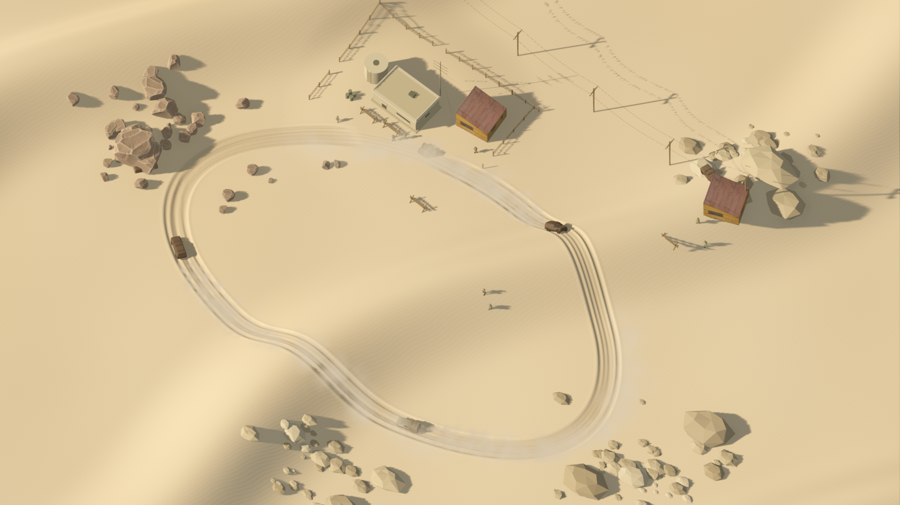
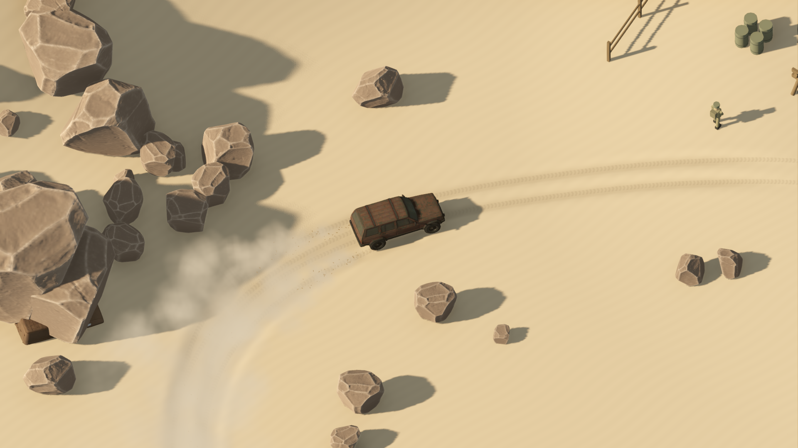

# Sirocco — Endless Drive desert tech demo

A playable source demo for **Godot 4.7.2 / Forward+**, composed for 1920×1080.
Three vehicles patrol a desert outpost, throwing layered dust and excavating
smooth, persistent tyre ruts. Take over the lead Jeep to drift and deepen the tracks.



## Run

Clone or download the **`codex/desert-tech-demo`** branch of this repository.
Keep the whole `godot/` directory: the demo shares the game's native vehicle,
building and rock assets. This is a Godot source demo, not a packaged executable.

On Windows, from the repository root:

```powershell
.\tools\desert-battlefield.ps1 Play -GodotPath 'C:\path\to\Godot_console.exe'
```

The launcher also accepts `GODOT_BIN` or Godot on PATH, imports assets on the first
run, and selects Forward+ without changing the main project settings.

The demo now automatically selects **Notebook** on an integrated GPU, including
the Intel Graphics in the Core Ultra 5 135U. Restart the demo to apply it; no scene
rebuild is needed. It retains the vehicles, particles, contact shadows, volumetric
haze and persistent tyre deformation. It culls distant terrain in small chunks,
uses 25 cm fine geometry and 2× MSAA, and omits the faint screen-space indirect-light
bounce. Rendering stays at native 1080p to preserve fine detail. Optional 85% FSR
upscaling provides a little more performance at the cost of fine-edge clarity.

```powershell
# Automatic selection (recommended on this notebook):
.\tools\desert-battlefield.ps1 Play
# Additional performance with slightly reduced internal resolution:
.\tools\desert-battlefield.ps1 Play -Quality Notebook -RenderScale 0.85
# Original full-quality rendering for comparison:
.\tools\desert-battlefield.ps1 Play -Quality Reference
# Weak GPUs: no SSAO/volumetric fog, 2 shadow cascades, 80% FSR:
.\tools\desert-battlefield.ps1 Play -Quality Low
# Real GPU benchmark; frame timing is uncapped and printed after warmup:
.\tools\desert-battlefield.ps1 Benchmark -Quality Auto -Duration 60
```

The scene root also exposes **Quality** in the editor. `Auto` uses the active GPU
type; explicit Notebook/Reference choices override it. For direct Godot launches,
append `-- --quality=notebook` or `-- --quality=reference`; `--render-scale=1` keeps
native resolution. Notebook reduces visible mesh density, not the physical sand
field or compaction rules. Very close views can show a slightly coarser rut edge.

Before the handling update, on this Core Ultra 5 135U / Intel Graphics notebook, matched 60-second tests at
1080p measured **17.7 → 32.5 FPS** (median-equivalent) at native resolution, or
**38.0 FPS** with the optional 85% FSR setting. Frame-time p95 improved from
67.98 to 37.99 ms at native resolution. See the scene documentation for logs and
test conditions; this is a local measurement, not a locked-60-FPS claim.

On other platforms, with `godot` on PATH:

```sh
godot --headless --editor --import --path godot --rendering-method forward_plus
godot --path godot --rendering-method forward_plus --resolution 1920x1080 res://desert_battlefield/desert_battlefield.tscn
```

For editing, import `godot/project.godot`, open
`res://desert_battlefield/desert_battlefield.tscn` and run that scene with **F6**.
Use Forward+ for the full lighting, fog and dust presentation.

## Controls

- **Space:** take control of the lead Jeep / return to cinematic mode.
- **W / up:** accelerate. **S / down:** brake; hold after stopping to reverse.
- **A/D or left/right:** steer, with a smaller steering angle at high speed.
- **Shift:** handbrake drift.
- **Escape:** return to autonomous patrol.
- **R:** reset the car — to the start of the current test, otherwise to its route.
- **P:** pause vehicles and particles (the orbit camera still moves).
- **C / Shift+C:** camera — Overview, Close top-down, Chase, Low chase, Orbit
  (drag with the mouse), Roof view.
- **+ / − / mouse wheel:** zoom or follow distance of the current camera
  (top-down down to an 8 m wide view).
- **1–9, 0 / T:** jump straight to a test (T = next, Shift+T = previous): asphalt
  slalom, gravel, clay, mud, water ford, moguls + jump, snow, ice, grass, wet
  asphalt, then (T) skid pad, dune jump, rocky trail.
- **V:** drive the next patrol car (Jeep / IZH van / Jeep).
- **Q:** switch graphics quality while playing (Notebook / Reference / Low).
- **H / F1:** controls overlay.

In manual driving a small readout shows **km/h**, total **kg**, ground type, ford
depth, reverse gear and airborne state, with camera/quality/FPS below. The
cinematic view stays free of UI.

## Test grounds

This build is a terrain test bed: the buildings and other props are gone, only
the Jeep and the IZH van remain, and the patrol no longer drives around (add
`-- --patrol` for the original cinematic diorama). You start in the Jeep.

East of the dunes (around x = 90, z = −78) a flattened course has six 47 m lanes
with their own procedural textures and physics: **asphalt** (grip 1.0, slalom
cones), **gravel** (0.66, shallow ruts), **clay** (0.76, cracked surface, medium
ruts), **mud** (0.42, high rolling loss, deep ruts, wet puddles), a **water ford**
(85 cm deep: drag, partial buoyancy, spray and wakes) and **moguls with a 1.2 m
tabletop jump**. South-west of the station is a 38 m **asphalt skid pad** for
cornering and rollover tests. North-east of the station a **rocky off-road trail**
winds twice over a dune ridge between sandstone boulders, with rock steps,
embedded stones and off-camber sections for handling practice. Tyre-mark ribbons
are no longer drawn; the much deeper sand ruts show where a car has been. The ford has an
interactive water surface: cars displace it, push bow waves and leave wakes that
reflect off the banks. Skidding on asphalt or rock leaves rubber marks, and ruts
are drawn right behind the wheels even in low chase views. The front-drive van can genuinely get stuck in the
mud and the deep ford; the 4×4 Jeep gets through. Grounds are part of the shared
height function, so wheels, ruts and rendering always agree.

## Vehicle handling and jumps

The chassis now has mass, linear/angular momentum, four spring/damper wheel
contacts and speed-dependent steering. The Jeep uses a tuned 1,850 kg / four-wheel
drive preset and the van a 1,450 kg / front-drive preset. These are gameplay tuning
values, not certified specifications. `mass_override_kg` and `payload_kg` on each
vehicle can be adjusted in the inspector; extra load compresses suspension and
reduces acceleration with the same motor.

Accelerate towards a dune and cross its crest to jump: there is no jump button.
When the wheels unload, gravity and momentum take over. Throttle and steering
cannot propel the vehicle through the air. On landing the suspension compresses,
rebounds and damps out. Tyres only dig ruts and emit dust when loaded, so jumps
leave gaps in the trail. Braking pitches the body forward; cornering produces roll
and sliding once the tyres exhaust their grip. Shift locks/slides the rear wheels.

Rollover threshold: both models previously tipped over in ordinary steering
(the van already at about 32 km/h on flat ground) while a handbrake slide stayed
upright, because full tyre grip acted at the contact patch below a high centre of
mass. Each axle now has an anti-roll bar, and below 54 km/h the lateral tyre force
acts at a raised roll-centre height; between 54 and 83 km/h the full lever arm
returns. Slow and moderate cornering therefore leans the body (3–6°) but no longer
flips it, while hard, fast cornering, dune slopes and jumps can still roll the car.
In a 100-start dune slalom test the van's flips fell from 10 to 2 at 43 km/h and
from 53 to 9 at 72 km/h; on flat ground it no longer flips below 72 km/h.

The chassis now rotates freely, including complete rollovers. Its centre of mass,
angular inertia, tyre forces and inelastic contact impulses use one consistent
frame. Terrain contacts include the actual model's roof, sides, bumpers and skid
plate. A car can settle on its roof or side; inverted wheels cannot drive or emit
sand. **R** returns it to the route and clears its momentum. The driving display
shows a rollover/reset hint. There is no crash damage, gearbox or tyre deformation.

Gravity is **9.81 m/s²** regardless of payload. Springs store a bounded amount of
energy, dampers dissipate it, and bump-stop position correction does not become an
upward launch impulse. Soft-sand rolling resistance also slows the approach.
A deterministic 16 m/s approach rises **1.43 m above takeoff** and lands; a 6 m/s
approach stays grounded. A deliberately extreme 24 m/s approach to this steep dune
can still jump much higher (about 8.2 m above takeoff). This follows its measured
vertical launch speed; clearance over the falling hillside is larger still.
The tests check the ballistic height bound and that an unpowered dune pass gains
no mechanical energy, rather than applying an artificial jump-height cap.

The automatic patrol follows the valley north of the station and anticipates
bends. Manual driving can cross every dune and can overturn. Ordinary sand
compaction is capped at a 28 cm bearing layer (34 cm while sliding); the previous
72–80 cm ruts trapped the newly physical chassis. The reconstructed surface stays
shared by rendering and physics. Handling, rollover/energy, sand and patrol
regressions are all included in the launcher's `Check` action.

The final rollover build passed `Check -Quality Notebook` and rendered jump/roof
captures. On this Core Ultra 5 135U / Intel Graphics notebook, a 60-second native
1080p run measured **32.06 ms median / 42.11 ms p95 / 54.46 ms p99**, equivalent
to **31.2 FPS at the median**. The camera/rendering settings are unchanged; the
patrol route and rock clearance were updated, so this is the current demo's
performance, not an isolated physics-cost comparison. See
`build/rollover-benchmark.log` and `build/rollover-render-final.log`.

## Included

- Jeep Cherokee and IZH-2715 meshes and materials from Endless Drive, with rotating
  wheels and front-wheel steering. Wheel support, dust and tread spacing match each rig.
- Two repair barracks and four desert rock variants reused from the main game,
  alongside the demo's relay station, barricades, poles and small patrol figures.
- Smooth dune displacement shared by rendering and vehicle support. Repeated
  passes deepen existing ruts and gradually approach a bounded depth.
- Cached tyre ribbons, local terrain patches and GPU dust/grain particles.
- Cinematic orthographic camera, warm shadows, ambient occlusion and atmospheric haze.

Deformation lasts for the current session. Dust is layered particles, not fluid
simulation. The cars use force-based suspension and tyre contacts; this demo does
not include Endless Drive's survival systems, save progression or combat.

## Verify and edit

```powershell
.\tools\desert-battlefield.ps1 Check
.\tools\desert-battlefield.ps1 Capture
```

Checks cover imported wheel alignment, tyre spacing, progressive soil depth,
terrain continuity, suspension, bounded caches, two minutes of patrol and manual
steering. Handling checks also cover payload, braking/reverse, top speed, airborne
momentum, gravity, landings, trail gaps, thin-wall collision and 30/60/120 Hz
consistency. Capture renders a native 1080p screenshot under `build/`.

The integrated demo passed these checks. A 60-second 1080p Forward+ run with 4× MSAA
on an RTX 3070 measured **8.52 ms median / 11.78 ms p95 / 12.46 ms p99** frame
intervals after warmup. These local wall-clock measurements are not a guarantee
for other hardware.



See [scene documentation](godot/desert_battlefield/README.md) for implementation,
measurements and the scene rebuild command. Rebuilding replaces the generated scene.

## Model credits

**Jeep Cherokee:** Renafox, **CC BY-NC-SA 4.0**. See the complete
[attribution, source and adaptation notes](godot/assets/models/jeep/ATTRIBUTION.md).
The model and its adaptations remain under those terms, including non-commercial use.

**IZH-2715:** model supplied by the project owner; native rig documented
[here](godot/assets/models/izh/README.md).

**Repair barracks and desert rocks:** models supplied by the project owner;
[source and conversion notes](godot/assets/models/supplied_environment/README.md).
No separate license information was supplied for those assets or the IZH model.
This demo does not assign a new license to them. See also the game's
[asset license inventory](godot/assets/ASSET_LICENSES.md).
